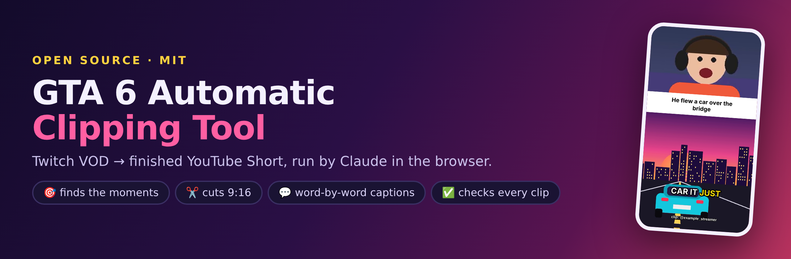
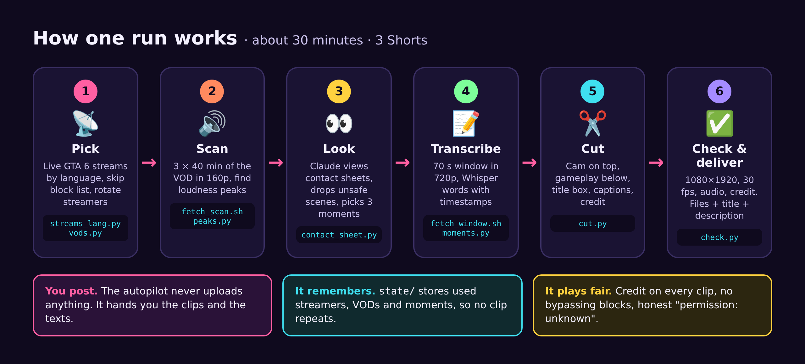
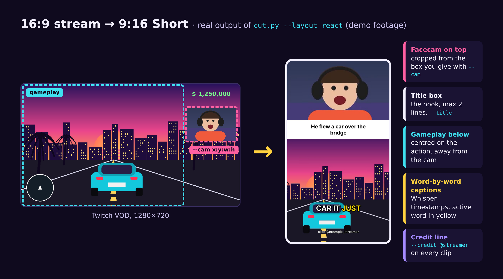
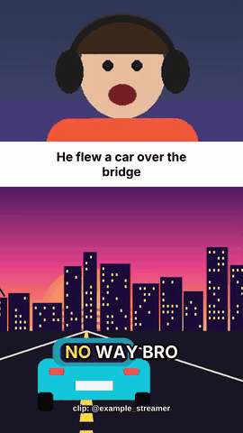
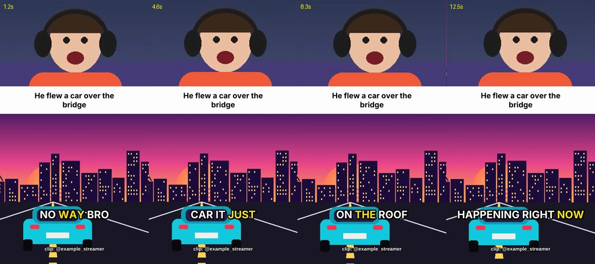
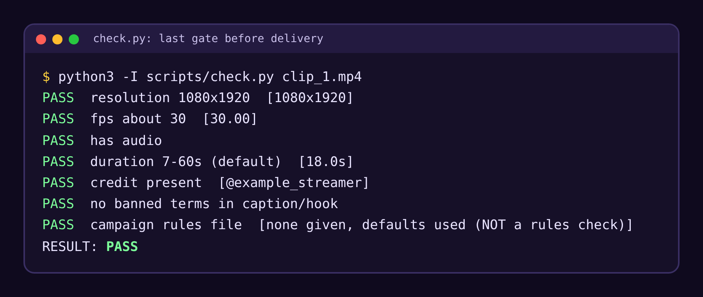

<p align="center">
  
</p>

<p align="center">
  <b>Turns GTA 6 Twitch streams into ready-to-post YouTube Shorts: on autopilot, run by Claude.</b><br>
  Picks a streamer · finds the best moments · cuts 9:16 · burns in word-by-word captions · checks every clip
</p>

<p align="center">
  
  
  
  
</p>

---

## What it does

<p align="center"></p>

You give Claude one instruction ("run the EN clip run, arrival 19:00"). Claude reads [`RUNBOOK.md`](RUNBOOK.md) and does the rest:

| Step | What happens | Script |
|---|---|---|
| 1. Pick | Lists live GTA VI streams in your language, skips your block list, rotates streamers | `tools/streams_lang.py`, `tools/vods.py` |
| 2. Scan | Downloads 3 × 40 min of the VOD in 160p and finds loudness peaks | `tools/fetch_scan.sh`, `tools/peaks.py` |
| 3. Look | Claude looks at contact sheets of the peaks and drops anything unsafe | `tools/contact_sheet.py` |
| 4. Transcribe | Downloads a 70 s window in 720p, Whisper gives every word a timestamp | `tools/fetch_window.sh`, `scripts/moments.py` |
| 5. Cut | Facecam on top, gameplay below, title box, captions, credit, -14 LUFS | `scripts/cut.py` |
| 6. Check | 1080×1920, 30 fps, audio, duration, credit, banned words | `scripts/check.py` |

At the end you get **3 MP4 files + a title + a description for each**. You post them yourself.

## The result

<p align="center"></p>

<table>
<tr>
<td width="32%" align="center"><br><sub>Demo clip (original test footage, rendered by <code>cut.py</code>)</sub></td>
<td>
<br>
<sub><code>tools/contact_sheet.py</code>: this is how Claude "watches" a clip before it ships it.</sub><br><br>

</td>
</tr>
</table>

> All images in this README were made with the tools in this repo from **original demo footage** (no real stream, no Rockstar assets).

## Quick start

### A) In Claude Code on the web (the intended setup)

1. **Fork** this repo (or use it as a template) and keep your own copy **private** if you will store your state in it (see [`state/README.md`](state/README.md)).
2. Open [claude.ai/code](https://claude.ai/code), start a session with your fork.
3. Send this prompt:

   ```text
   Read RUNBOOK.md and do one run. LANG=EN, arrival 19:00 (Europe/Berlin).
   ```

4. Optional: make it **fully automatic** with scheduled tasks, one per run, for example 09:00, 14:00 and 19:00 with the same prompt.

Claude runs `bootstrap.sh`, picks a streamer, cuts 3 clips, checks them, sends you the files with titles and descriptions, and commits what it used to `state/` so the next run does not repeat a moment.

### B) Locally, by hand

```bash
git clone https://github.com/AcelezXYZ/GTA-6-Automatic-Clipping-Tool-for-Claude-Browser-.git
```

```bash
cd GTA-6-Automatic-Clipping-Tool-for-Claude-Browser- && bash bootstrap.sh
```

```bash
export GTAVI="$PWD" CLIP_DESK_HOME="$HOME/clip-work"
```

```bash
python3 -I tools/streams_lang.py EN 20
```

Then follow the phases in [`RUNBOOK.md`](RUNBOOK.md) step by step. Example cut:

```bash
python3 -I scripts/cut.py "$CLIP_DESK_HOME/jobs/<job>" --pick 1 --layout react --cam 0.75:0.19:0.23:0.27 \
  --title 'He flew a car over the bridge' --title-style box --captions word \
  --credit @example_streamer --start 12.4 --end 38.0
```

**Requirements:** Python 3.10+, `ffmpeg`/`ffprobe` with libass, `yt-dlp`. Python packages are in [`requirements.txt`](requirements.txt); `bootstrap.sh` installs missing ones and pre-loads the Whisper `small` model (CPU, int8).

## Repo layout

```text
.
├── RUNBOOK.md          ← the instructions Claude follows on every run
├── bootstrap.sh        ← checks programs, installs packages, loads Whisper
├── scripts/            ← core engine
│   ├── moments.py      ← loudness + hype words + chat → best moments, Whisper transcript
│   ├── cut.py          ← 9:16 layouts (react / facecam / blur / fill), captions, title, credit
│   ├── check.py        ← pre-post checks, optional campaign rules
│   ├── facecam.py      ← automatic webcam detection (--cam auto)
│   ├── twitch.py       ← keyless Twitch helpers (public GQL, anonymous IRC chat)
│   └── live.py, streams.py, trends.py, translate.py, questions.py, secrets_map.py, payouts.py
├── tools/              ← run helpers: stream list, VOD list, downloads, peaks, contact sheet, caption fixes
├── state/              ← templates for the autopilot's memory (watchlist, campaigns, runs, log)
└── docs/
    ├── playbook.md     ← full prompt for running a faceless GTA 6 clip page
    └── images/
```

### Layouts in `cut.py`

| `--layout` | Use it when |
|---|---|
| `react` | the streamer has a facecam: cam on top, title box in the middle, gameplay below |
| `facecam` | same idea, without the title band |
| `blur` | no facecam: full frame in the middle, blurred copy as background |
| `fill` | crop the centre of the frame to 9:16 |

Caption styles: `--captions word` (word by word, active word in yellow), `bubble`, `none`.

## Rules the autopilot follows

The full list is in [`RUNBOOK.md`](RUNBOOK.md#hard-rules). The short version:

- ✅ **Credit on every clip** and a source link with timestamp in the description.
- ✅ **Captions on every clip.**
- 🚫 **Never uploads or posts.** A human posts.
- 🚫 **Never gets around blocks** (403, bot checks, rate limits): it reports them and moves on.
- 🚫 **Never clips** nudity, club scenes, gore, hate, personal data, or streamers who look like minors.
- ⚖️ **Honest about rights:** every delivery says "campaign: yes/no, permission: unknown" unless permission is documented.

## ⚠️ Disclaimer

This is a fan tool. It is **not affiliated with Rockstar Games, Take-Two Interactive, Twitch or YouTube**.
Grand Theft Auto and GTA are trademarks of their owners.

Stream footage belongs to the streamers. **This tool does not give you the right to re-upload anyone's content.**
Check each creator's rules, prefer streamers with an official clipping campaign or written permission, honour takedown
requests, and follow the terms of Twitch and of the platform you post on. You are responsible for what you publish.

## Contributing

Issues and pull requests are welcome. Good first ideas:
- more layouts (split-screen, picture-in-picture)
- better moment scoring (chat replay for Twitch VODs)
- more hype-word lists for other languages in `scripts/moments.py`

Please keep the rules above intact in any change to `RUNBOOK.md`.

## License

[MIT](LICENSE) © 2026 Acelez (AcelezXYZ). The core scripts in `scripts/` started from an MIT-licensed project by
Bodila51 (gtavi-claudecode), whose original repository no longer exists; its copyright notice is kept in [`LICENSE`](LICENSE)
as the MIT license requires.
